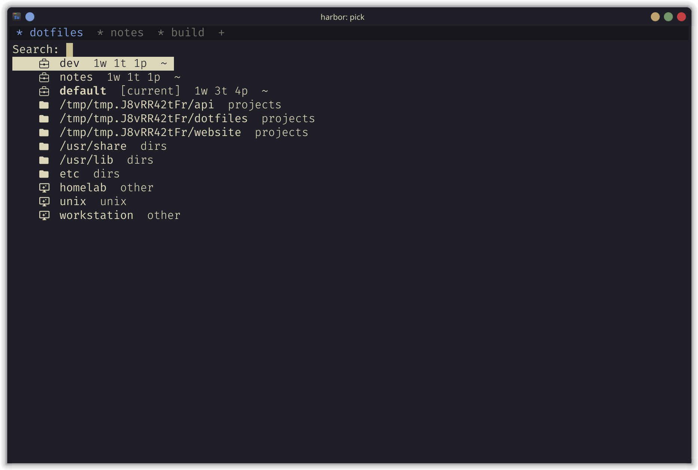
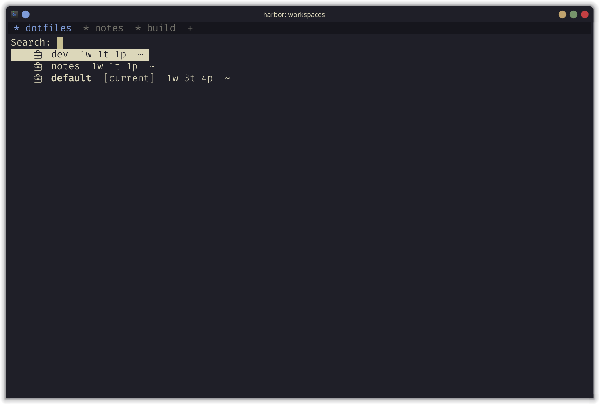
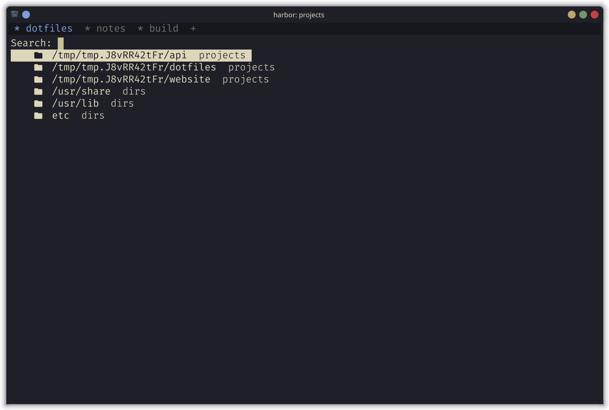
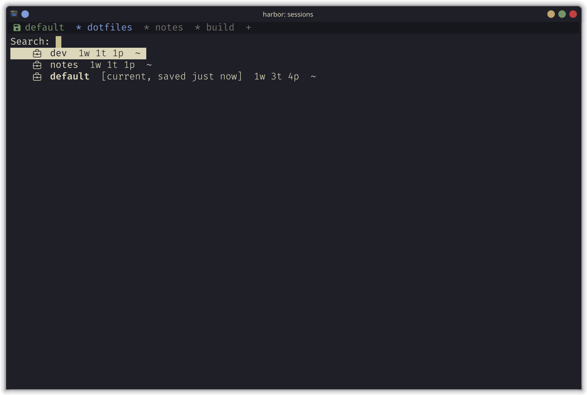
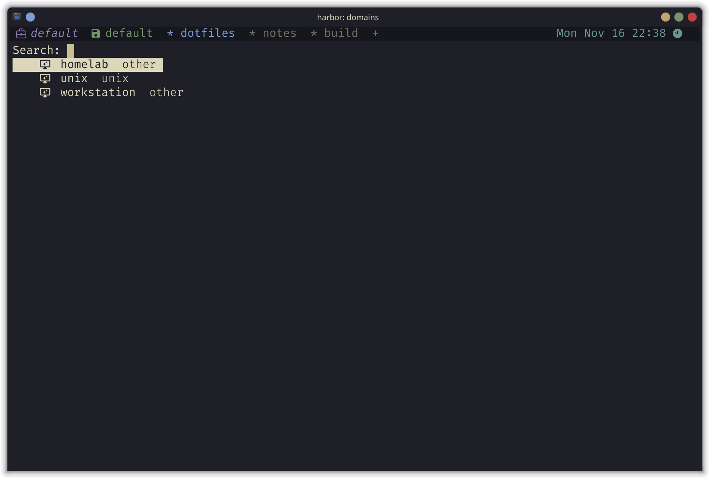

# harbor.wz [](https://github.com/sravioli/harbor.wz/releases/latest)

<!-- [](https://github.com/michaelbrusegard/awesome-wezterm) -->

[](https://github.com/sravioli/harbor.wz/actions/workflows/tests.yaml)
[](https://github.com/sravioli/harbor.wz/actions/workflows/lint.yaml)
[](https://coveralls.io/github/sravioli/harbor.wz)
[](../LICENSE)
[](../LICENSE-DOCS)

Manage workspaces and saved sessions in [WezTerm](https://wezterm.org/).

Find workspaces, saved layouts, directories, and domains in one picker.
Save windows, tabs, splits, and working directories, then rebuild them with
optional scrollback and allowlisted foreground-command replay.

[Showcase](#showcase) · [Quick start](#quick-start) · [Usage](#usage) · [Configuration](#configuration) · [API reference](#api-reference) · [Troubleshooting](#troubleshooting) · [Development](#development) · [License](#license)

## Showcase

Every `harbor.action.*` function returns a key assignment that opens a picker. The bar is [mosaic.wz](https://github.com/sravioli/mosaic.wz) with `harbor.session`. The screenshots show [kanagawa-wave](https://github.com/kanagawa-community/wezterm) (dark) and [kanagawa-lotus](https://github.com/kanagawa-community/wezterm) (light), in Fira Code Nerd Font.

### `harbor.action.pick()`

Everything in one list: live workspaces with their window, tab and pane counts, pinned directories, projects and domains.

<picture>
  <source media="(prefers-color-scheme: light)" srcset="assets/pick/light.png">
  
</picture>

<details>
<summary>The other four pickers</summary>

### `harbor.action.workspaces()`

Only the live workspaces. The current one is marked.

<picture>
  <source media="(prefers-color-scheme: light)" srcset="assets/workspaces/light.png">
  
</picture>

### `harbor.action.projects()`

Git projects found under `sources.projects.roots`, and your pinned directories.

<picture>
  <source media="(prefers-color-scheme: light)" srcset="assets/projects/light.png">
  
</picture>

### `harbor.action.sessions()`

Saved sessions. Enter switches to a running workspace or restores one that is not running. In the bar, `harbor.session` marks a workspace that has a saved session.

<picture>
  <source media="(prefers-color-scheme: light)" srcset="assets/sessions/light.png">
  
</picture>

### `harbor.action.domains()`

Your configured mux domains. Each opens as its own workspace.

<picture>
  <source media="(prefers-color-scheme: light)" srcset="assets/domains/light.png">
  
</picture>

</details>

## Quick start

### Requirements

Requires **[WezTerm nightly including the prompt-prefill fix (2024-09-22) or newer](https://github.com/wezterm/wezterm/commit/67603e73e05cc6c3818a6b474b923f0e9e6ce971)**
and Git. Stable builds lack required prompt and JSON APIs.
Configure remote domains beforehand. WSL domains need Windows/WSL.

Automatically loads [warp.wz](https://github.com/sravioli/warp.wz),
[memo.wz](https://github.com/sravioli/memo.wz),
[log.wz](https://github.com/sravioli/log.wz), and
[warden.wz](https://github.com/sravioli/warden.wz). Missing dependencies raise.
Optional [sigil.wz](https://github.com/sravioli/sigil.wz) and
[ribbon.wz](https://github.com/sravioli/ribbon.wz) provide labels with built-in
fallbacks. Local API modules take precedence.

**zoxide** supplies optional directory history. **fd/fdfind** accelerates
project discovery, with a Lua-walk fallback. Closing workspaces needs WezTerm's
CLI. Icons have text fallbacks.

### Install and run

Put this in `wezterm.lua`:

```lua
local wezterm = require "wezterm"
local harbor = wezterm.plugin.require "https://github.com/sravioli/harbor.wz"
local config = wezterm.config_builder()

harbor.apply_to_config(config)
config.keys = {
  { key = "h", mods = "CTRL|SHIFT", action = harbor.action.pick() },
}

return config
```

Press **Ctrl+Shift+H**, type to filter, and press Enter to open an entry.
Esc cancels. `apply_to_config` initializes defaults and registers the action
table, but does not bind keys. Reuse your existing config builder and append
the binding before returning.

## Usage

### Open and organize workspaces

Press Enter to switch to a live workspace, restore a session that is not
running, or open a directory or domain. Directory entries come from zoxide,
project discovery, pinned paths, and custom sources.

| Picker key | Action                                                                                      |
| ---------- | ------------------------------------------------------------------------------------------- |
| `Ctrl+D`   | Ask, then close the selected live workspace, or delete a saved-only session and its backup. |
| `Ctrl+R`   | Prompt to rename a workspace/session. An existing live destination merges workspaces.       |
| `Ctrl+A`   | Prompt for a new workspace name.                                                            |
| `Ctrl+O`   | Prompt for a directory, prefilled from the selection when available.                        |
| `Ctrl+S`   | Save the selected live workspace.                                                           |

Ctrl+D and `harbor.action.close()` ask first. "No" is preselected and Esc
cancels. Set `picker.confirm = false` to skip the question. Closing saves the
workspace first and aborts if that save fails (`sessions.save_on_close`), so a
closed workspace stays restorable. A workspace protected after a partial
restore is closed without overwriting its snapshot. Closing a workspace targets
all its panes, and Harbor refuses to close the only workspace. A failed mux or
saved-file operation can leave a rename or merge partly complete. Check diagnostics before retrying. InputSelector keeps its
Ctrl+N/P/J/K navigation and cancel keys.

### Save and resume a session

Bind `harbor.action.save()` to capture the active workspace and
`harbor.action.restore()` to prompt for a saved name. Restoring an already-live
name switches to it rather than overwriting it. Saved entries show how long ago
they were saved.

WezTerm has no event before it quits. To save on exit, bind
`harbor.action.quit()` where you quit: it saves every live workspace, then quits,
and refuses to quit when a save fails. Closing windows through the window
manager, or closing the last pane, bypasses it. Enable autosave for those cases.

Tabs and windows can also be saved on their own and loaded back later. A tab
snapshot is added to the current window. A window snapshot opens in the active
workspace. Snapshots appear in the picker as `tab` and `window` entries.
`Ctrl+D` deletes them and `Ctrl+R` renames them. A snapshot never replaces or
overwrites a workspace session of the same name. If you set `sources.order`
yourself, add `"snapshots"` to it or the snapshot entries will not appear.

Sessions preserve windows and tabs, splits, git branches, directories, domains, tab and window
titles, focus, and zoom. Scrollback captures sanitized text and SGR colors,
but skips the alternate screen. Harbor replays only allowlisted local foreground
command arguments. It does not restore process memory, unsaved buffers, or
complete shell state.

Restore only session files you trust. An allowlisted program can execute commands
through its arguments or configuration. The allowlist is not a sandbox.
Disable replay if that is unsuitable for your setup. Harbor rejects saved
arguments that contain control characters (other than tab), but cannot judge
what a program does with the rest.

Scrollback can hold secrets. On Linux and macOS Harbor restricts the
`sessions` directory to its owner (`chmod 700`) the first time it writes there.
The files inside keep their own mode, but other users cannot reach them.
On Windows it relies on the permissions of your profile folder. Do not sync or
share the directory.

### Add project directories and a layout

Before `apply_to_config`, configure discovery and a simple two-tab layout:

```lua
harbor.setup {
  sources = {
    projects = { roots = { "~/dev" } },
    dirs = { paths = { wezterm.home_dir } },
  },
  layouts = {
    default = { tabs = { { title = "edit" }, { title = "run" } } },
  },
}
```

For a new workspace, tabs accept `cwd` (root-relative), `args`, `env`, `cmd`,
`active`, and `splits`. Splits add `direction` (`Right`, `Left`, `Bottom`, `Top`), `size`
(`0.05..0.95`), and nested splits. `args` replaces the shell and suppresses `cmd`.
Otherwise Harbor types the trusted `cmd` text into the shell.
See the [layout schema](../plugin/harbor/layout.lua).

Harbor calls custom sources without arguments. They return path strings,
`{ path, label? }`, or `{ workspace, path?, label? }` records. Layout functions receive
`{ name, root, domain, window, tab, pane }`. Rule predicates receive `(root, name)`.

## Configuration

### Example

Setup is optional and replaces the current settings. Call it before
`apply_to_config`, and register any adapter between those calls.
The values below are overrides, not defaults:

```lua
harbor.setup {
  picker = { icons = false },
  sessions = {
    processes = { enabled = false },
    autosave = { enabled = true, interval = 120 },
  },
}
```

### Options

#### Naming and sources

| Option                            | Type                          | Default                                                                              | Description                                                                                  |
| --------------------------------- | ----------------------------- | ------------------------------------------------------------------------------------ | -------------------------------------------------------------------------------------------- |
| `default_workspace`               | `string`                      | `"default"`                                                                          | Fallback active name when the mux cannot report it. Non-empty.                               |
| `naming.style`                    | `"basename"\|"tilde"\|"path"` | `"basename"`                                                                         | Derive directory workspace names.                                                            |
| `naming.replace_dots`             | `boolean`                     | `false`                                                                              | Replace dots with underscores in derived names.                                              |
| `naming.max_length`               | `integer`                     | `64`                                                                                 | Base-name width limit in columns, `8..256`. Collision suffixes can extend it.                |
| `naming.fn`                       | `fun(path: string): string`   | `nil`                                                                                | Custom non-empty name wins before built-in replacement/truncation. Errors log and fall back. |
| `sources.order`                   | `string[]`                    | `{ "workspaces", "saved", "snapshots", "zoxide", "projects", "dirs", "domains" }`    | Built-in collection order. Custom sources run afterward.                                     |
| `sources.cache_ttl`               | `number`                      | `30`                                                                                 | Project/zoxide cache seconds, minimum `0`. `0` bypasses caching.                             |
| `sources.workspaces.enabled`      | `boolean`                     | `true`                                                                               | Include live workspaces.                                                                     |
| `sources.saved.enabled`           | `boolean`                     | `true`                                                                               | Include sessions on disk.                                                                    |
| `sources.snapshots.enabled`       | `boolean`                     | `true`                                                                               | Include saved tab and window snapshots.                                                      |
| `sources.zoxide.enabled`          | `boolean`                     | `true`                                                                               | Query zoxide if installed.                                                                   |
| `sources.zoxide.path`             | `string?`                     | `nil`                                                                                | Explicit executable name/path.                                                               |
| `sources.zoxide.min_score`        | `number`                      | `0`                                                                                  | Minimum returned score.                                                                      |
| `sources.zoxide.limit`            | `integer`                     | `300`                                                                                | Non-negative result cap. `0` is unlimited.                                                   |
| `sources.zoxide.add_on_open`      | `boolean`                     | `true`                                                                               | Best-effort `zoxide add` when opening a directory.                                           |
| `sources.projects.enabled`        | `boolean`                     | `true`                                                                               | Discover Git roots.                                                                          |
| `sources.projects.roots`          | `(string\|table)[]`           | `{}`                                                                                 | Paths or `{ path, max_depth? }`. `~/dev` is an example, not a default.                       |
| `sources.projects.max_depth`      | `integer`                     | `4`                                                                                  | Directory depth, `1..16`. Per-root depth overrides it.                                       |
| `sources.projects.exclude`        | `string[]`                    | `{ "node_modules", ".cache", ".venv", "venv", "target", "vendor", "dist", "build" }` | Excluded directory names/patterns for discovery.                                             |
| `sources.projects.fd_path`        | `string?`                     | `nil`                                                                                | Explicit fd path. Otherwise try fd/fdfind before walking.                                    |
| `sources.projects.include_roots`  | `boolean`                     | `false`                                                                              | Include configured roots even when not Git projects.                                         |
| `sources.dirs.enabled`            | `boolean`                     | `true`                                                                               | Include pinned directories.                                                                  |
| `sources.dirs.paths`              | `string[]`                    | `{}`                                                                                 | Non-empty directory paths. Leading `~` expands.                                              |
| `sources.domains.enabled`         | `boolean`                     | `true`                                                                               | Include configured spawnable mux domains.                                                    |
| `sources.domains.kinds`           | `string[]`                    | `{ "ssh", "sshmux", "wsl", "unix", "tls", "other" }`                                 | Allowed categories. `"local"` is accepted but omitted by default.                            |
| `sources.domains.ignore`          | `string[]`                    | `{}`                                                                                 | Exact names to exclude.                                                                      |
| `sources.domains.ignore_patterns` | `string[]`                    | `{}`                                                                                 | Lua patterns to exclude, not regexes.                                                        |
| `sources.domains.action`          | `"workspace"\|"tab"`          | `"workspace"`                                                                        | Open a domain as its own workspace or a new tab.                                             |
| `sources.custom`                  | `function[]`                  | `{}`                                                                                 | Additional source callbacks. See [Usage](#add-project-directories-and-a-layout).             |

#### Picker

| Option                         | Type                                              | Default           | Description                                                                                                                                  |
| ------------------------------ | ------------------------------------------------- | ----------------- | -------------------------------------------------------------------------------------------------------------------------------------------- |
| `picker.title`                 | `string`                                          | `"Harbor"`        | Selector title.                                                                                                                              |
| `picker.fuzzy`                 | `boolean`                                         | `true`            | Initial fuzzy mode. Fuzzy prompt remains `"Search: "`.                                                                                       |
| `picker.description`           | `string?`                                         | `nil`             | Explicit exact-mode description. Otherwise generated top hints when enabled.                                                                 |
| `picker.show_current`          | `boolean`                                         | `true`            | Show the active workspace.                                                                                                                   |
| `picker.counts`                | `boolean`                                         | `true`            | Show each live workspace's size as `2w 3t 5p` (windows, tabs, panes). Counts panes on every picker open. Turn off for very large workspaces. |
| `picker.icons`                 | `boolean`                                         | `true`            | Add glyphs/text fallback markers.                                                                                                            |
| `picker.sort`                  | `"mru"\|"alpha"\|"none"`                          | `"mru"`           | Group by kind, then sort. `"none"` keeps collection order.                                                                                   |
| `picker.path_width`            | `integer`                                         | `60`              | Target path width, `10..200` columns. Warp shortening is best-effort.                                                                        |
| `picker.hints`                 | `boolean`                                         | `true`            | Master generated-hint switch, not an action-key switch.                                                                                      |
| `picker.hint_position`         | `"top"\|"status"\|"none"`                         | `"top"`           | Exact description, host status adapter, or no generated hints.                                                                               |
| `picker.confirm`               | `boolean`                                         | `true`            | Ask before closing a workspace or deleting a saved session from the picker or `action.close()`.                                              |
| `picker.filter`                | `fun(entry: harbor.Entry): boolean`               | `nil`             | Only explicit `false` hides an entry. Errors log and retain it.                                                                              |
| `picker.format`                | `fun(entry: harbor.Entry, label: string): string` | `nil`             | Customize a rendered label. Errors/non-strings keep the original.                                                                            |
| `picker.key_table`             | `string`                                          | `"harbor_picker"` | Non-empty native action-table name.                                                                                                          |
| `picker.keys.delete.key`       | `string`                                          | `"d"`             | Close/delete action key.                                                                                                                     |
| `picker.keys.delete.mods`      | `string`                                          | `"CTRL"`          | Close/delete modifiers.                                                                                                                      |
| `picker.keys.rename.key`       | `string`                                          | `"r"`             | Rename action key.                                                                                                                           |
| `picker.keys.rename.mods`      | `string`                                          | `"CTRL"`          | Rename modifiers.                                                                                                                            |
| `picker.keys.new.key`          | `string`                                          | `"a"`             | New-workspace action key.                                                                                                                    |
| `picker.keys.new.mods`         | `string`                                          | `"CTRL"`          | New-workspace modifiers.                                                                                                                     |
| `picker.keys.new_at_path.key`  | `string`                                          | `"o"`             | Open-directory action key.                                                                                                                   |
| `picker.keys.new_at_path.mods` | `string`                                          | `"CTRL"`          | Open-directory modifiers.                                                                                                                    |
| `picker.keys.save.key`         | `string`                                          | `"s"`             | Save action key.                                                                                                                             |
| `picker.keys.save.mods`        | `string`                                          | `"CTRL"`          | Save modifiers.                                                                                                                              |

#### Layouts and sessions

| Option                               | Type                  | Default         | Description                                                                                                                                                                                                                |
| ------------------------------------ | --------------------- | --------------- | -------------------------------------------------------------------------------------------------------------------------------------------------------------------------------------------------------------------------- |
| `layouts.dir`                        | `string?`             | `nil`           | Directory containing named `<name>.lua` layouts.                                                                                                                                                                           |
| `layouts.default`                    | `string\|table?`      | `nil`           | Fallback layout name/table.                                                                                                                                                                                                |
| `layouts.rules`                      | `table[]`             | `{}`            | First matching `{ match, layout }`. Match is a Lua pattern or predicate.                                                                                                                                                   |
| `layouts.project_file`               | `string`              | `".harbor.lua"` | Project-root layout file. `""` disables lookup.                                                                                                                                                                            |
| `layouts.trust_project_files`        | `boolean`             | `false`         | Allow executing project layout Lua. Enable only for trusted roots.                                                                                                                                                         |
| `sessions.dir`                       | `string?`             | `nil`           | Platform data root when omitted. Sessions live in its `sessions` subdirectory.                                                                                                                                             |
| `sessions.backup`                    | `boolean`             | `true`          | Retain previous session JSON as `.bak`.                                                                                                                                                                                    |
| `sessions.save_on_close`             | `boolean`             | `true`          | Save a workspace before closing it. A failed save aborts the close.                                                                                                                                                        |
| `sessions.max_file_bytes`            | `integer`             | `33554432`      | Read/write size cap in bytes, minimum `1024`. Not a streaming read limit.                                                                                                                                                  |
| `sessions.git_branch`                | `boolean`             | `true`          | Record each local pane's git branch when saving and warn on restore when it changed. Runs `git` once per directory per save or autosave check, and only inside a repository (a `.git` entry in the directory or a parent). |
| `sessions.scrollback.enabled`        | `boolean`             | `true`          | Capture/replay bounded scrollback outside the alternate screen.                                                                                                                                                            |
| `sessions.scrollback.max_lines`      | `integer`             | `3500`          | Non-negative capture line cap. `0` disables capture.                                                                                                                                                                       |
| `sessions.scrollback.max_pane_bytes` | `integer`             | `524288`        | Non-negative byte cap per pane. `0` disables this byte cap.                                                                                                                                                                |
| `sessions.scrollback.remote`         | `boolean`             | `false`         | Permit capture from remote panes.                                                                                                                                                                                          |
| `sessions.processes.enabled`         | `boolean`             | `true`          | Capture/replay allowlisted local foreground argv.                                                                                                                                                                          |
| `sessions.processes.allow`           | `string[]`            | `{}`            | Extra lowercase basenames, without `.exe`. Built-ins include editors, pagers, monitors, and file managers.                                                                                                                 |
| `sessions.processes.mode`            | `"extend"\|"replace"` | `"extend"`      | Extend the [built-in allowlist](../plugin/harbor/config.lua), or use only `allow`.                                                                                                                                         |
| `sessions.processes.delay`           | `number`              | `0.3`           | Replay delay in seconds, `0..10`. Not an application-readiness check.                                                                                                                                                      |
| `sessions.autosave.enabled`          | `boolean`             | `false`         | Enable periodic autosave.                                                                                                                                                                                                  |
| `sessions.autosave.interval`         | `number`              | `300`           | Seconds between passes, minimum `10`.                                                                                                                                                                                      |
| `sessions.autosave.on_focus_lost`    | `boolean`             | `false`         | Also save on focus loss when autosave is enabled.                                                                                                                                                                          |
| `sessions.autosave.scope`            | `"all"\|"active"`     | `"all"`         | Periodic-pass targets. Focus-loss saving targets that window's workspace.                                                                                                                                                  |
| `sessions.autosave.exclude`          | `string[]`            | `{}`            | Exact workspace exclusions for periodic passes and `save_all`/`quit`, not the focus-loss path.                                                                                                                             |
| `sessions.restore_on_startup`        | `boolean\|string`     | `false`         | Restore a named session. `true` uses the last recorded workspace.                                                                                                                                                          |

### Behavior and precedence

Warden logs invalid fields and falls back to defaults for those fields, leaving
valid options in place. Unknown fields produce warnings and remain. Setup
starts from schema defaults, normalizes maps by field, and replaces lists.
Options do not persist. Setup registers events and timers without scanning
directories or changing workspaces. Loading dependencies may download plugins.

Harbor chooses layouts in this order: an explicit per-call layout, a trusted
project file, the first matching rule, then the default. Live workspaces win
over matching saved sessions and directories. It caches zoxide and project
results. `refresh` invalidates that cache.

Data uses `%LOCALAPPDATA%\wezterm\harbor` on Windows (home AppData fallback),
`~/Library/Application Support/wezterm/harbor` on macOS, and
`$XDG_STATE_HOME/wezterm/harbor` or `~/.local/state/wezterm/harbor` on Linux.
Harbor creates directories on demand for `history.json` and encoded
`sessions/*.json` names. Keep data outside the watched config directory.
Windows directory creation rejects cmd metacharacters.

Autosave tracks layout, directory, tab title, foreground program and git branch
changes, not scrollback-only changes.
Failed saves are retried. After a partial restore, close, or merge, Harbor
blocks autosave for the affected names. That protection survives reloads and
cache clearing, but not a restart. A successful explicit save accepts the
current partial layout and clears protection. It can replace a good snapshot,
so inspect the workspace first. A new timer generation stops old loops between
targets and before they reschedule.

Fuzzy input replaces the native description, so top hints cannot stay above it.
Status hints need an adapter and a visible status bar. Harbor never enables a bar
or falls back to top hints. Disabling hints retains explicit descriptions.

## API reference

The [API reference](../docs/api.md) lists every function, method, and value
with its parameters and return values. It is generated from the LuaLS
annotations in `plugin/`, so it matches the code. It has these sections:

- [harbor](../docs/api.md#harbor)
- [harbor.action](../docs/api.md#harboraction)
- [Types](../docs/api.md#types)

`?` marks optional or nullable values. Run scanning, saving, and mux operations
inside WezTerm callbacks, which supply `window` and `pane`.
Use `.` for module and action-factory calls.

### Configuration and operations

Entries have a `kind` (`workspace`, `saved`, `dir`, `domain`), typed `id`,
and kind-specific fields and flags in the [annotations](../plugin/harbor/sources/init.lua).

An adapter has optional native `keys` and an `open(window, pane, session)` callback.
For status hints, the session contains `{ key_table, bindings }`. Return an
idempotent cleanup function for acceptance, cancellation, action dispatch,
reopening, and handled errors. If the adapter throws before returning, it must
clean up itself. Harbor installs extra keys only when status hints are enabled.
Avoid stacking unrelated tables: Harbor pops its own table only when it is
on top. Chord integration uses the generic `temporary` API.
Chord is not a dependency.

### Events and constants

Events emit `(window, pane, payload)`. Background operations may pass nil
window/pane. Event-handler errors log instead of aborting the operation.

| Constant         | Value                         | Meaning                                       |
| ---------------- | ----------------------------- | --------------------------------------------- |
| `harbor.VERSION` | `"0.1.0"`                     | Plugin version string.                        |
| `harbor.events`  | List of the event names below | Event discovery. Not a registration function. |

| Event                            | Payload                                                                                                                        |
| -------------------------------- | ------------------------------------------------------------------------------------------------------------------------------ |
| `harbor.workspace.switching`     | `{ name, from }`. Fires before the switch, so a handler can still read the outgoing workspace.                                 |
| `harbor.workspace.switched`      | `{ name, from }`                                                                                                               |
| `harbor.workspace.created`       | `{ name, path? }`                                                                                                              |
| `harbor.workspace.renamed`       | `{ from, to, merged }`                                                                                                         |
| `harbor.workspace.closed`        | `{ name, panes }`                                                                                                              |
| `harbor.workspace.forked`        | `{ from, to }`                                                                                                                 |
| `harbor.session.saved`           | `{ name }`, plus `kind = "tab"\|"window"` for snapshots.                                                                       |
| `harbor.session.restored`        | `{ name }`, plus `kind` for snapshots.                                                                                         |
| `harbor.session.deleted`         | `{ name }`, plus `kind` for snapshots.                                                                                         |
| `harbor.session.branch_mismatch` | `{ name, mismatches }`. Each mismatch is `{ path, saved, current }`. Emitted after a restore when a pane is on another branch. |
| `harbor.picker.opened`           | `{ title, count }`. Fires when the selector opens, including reopenings after an action.                                       |
| `harbor.picker.selected`         | `{ entry }`. Enter accepted an entry (in-picker action keys do not fire it).                                                   |
| `harbor.picker.canceled`         | `{}`. The selector closed without a choice.                                                                                    |

### mosaic integration

harbor ships `harbor.session` for the
[mosaic.wz](https://github.com/sravioli/mosaic.wz) status bar. It shows a
marker while the active workspace has a saved session, and it updates on
save, delete, switch and rename. mosaic reads the module only when a layout
names it.

```lua
mosaic.setup {
  layout = { left = { "workspace", "harbor.session" } },
  options = {
    ["harbor.session"] = {
      name = true,  -- optional: also show the workspace name (default: false)
      icon = false, -- optional: hide the glyph (default: md_content_save)
    },
  },
}
```

## Troubleshooting

### A restore is partial or fails

Harbor checks pane trees before spawning anything. Missing local directories
or unavailable domains cause an error rather than a different destination.
Failures in window or tab creation, splits, titles, focus, zoom, output, or
scheduling return `false, error` with context. Harbor then logs the full
error, closes every pane the restore created, and cancels pending command
replay. It does not switch or emit a success event, so you can retry right away. If the
rollback cannot close a pane, the partial workspace stays open and autosave
stays blocked for it. Restore on startup does not roll back, so WezTerm never
starts without a window.

A successful return does not guarantee that an editor started. If replay fails
later, Harbor logs the error and blocks autosave. Running programs control
subsequent pane titles.

### Recover a backup without overwriting the primary

From an action callback use
`harbor.restore(window, pane, "dev", { backup = true })`.
Harbor never promotes a backup automatically, even if the primary is corrupt
or oversized. It checks writes before replacing files and keeps `.bak` by
default. Each write goes to its own temporary file, which Harbor then renames
over the target. Harbor copies the backup the same way first. Concurrent
writers therefore cannot corrupt a session (the last complete save wins), and
the primary is never missing on POSIX systems. On Windows a replacement still takes two renames.
There is no `fsync`. A power loss can still lose the latest save.

### Close or rename reports failure

Close uses `wezterm cli --no-auto-start kill-pane --pane-id ...` with captured
IDs. If some pane kills fail, Harbor keeps history and path metadata and does
not emit a full-close event. Merge and saved-session rename failures are reported
instead of overwriting colliding names.

Check **Ctrl+Shift+L**, missing optional executables, and data permissions.
After publication, update with `wezterm.plugin.update_all()` and reload.
Report [issues](https://github.com/sravioli/harbor.wz/issues) with sanitized
options, plugin/WezTerm revisions, and logs. Do not attach private scrollback.

## Development

### Local checkout

Load the working tree directly, so edits take effect on the next config
reload without a commit or a plugin update. Adjust the path to your clone:

```lua
local wezterm = require "wezterm"
local root = wezterm.home_dir .. "/path/to/harbor.wz/plugin/"
package.path = root .. "?.lua;" .. root .. "?/init.lua;" .. package.path
local harbor = require "harbor.api"
```

Offline loading needs sibling APIs on `package.path`. Specs require all six checkouts.

### Editor support

Add `plugin` to [LuaLS's library](https://luals.github.io/wiki/settings/#workspacelibrary).
[wezterm-types](https://github.com/DrKJeff16/wezterm-types) has no Harbor entry.
The local API also lacks a named module class:

```lua
---@type table
local harbor = wezterm.plugin.require "https://github.com/sravioli/harbor.wz"
```

The generic annotation does not describe Harbor's methods. See the
[API](../plugin/harbor/api.lua), [schema](../plugin/harbor/config.lua), and `harbor.Entry`.

### Checks and contributions

From the repository root, with Lua 5.4 and the named tools installed:

```sh
busted --verbose
luacheck plugin spec
selene --display-style=quiet plugin
stylua --check plugin spec
```

Tests use mocked mux APIs and temporary data with real dependencies. CI runs
the same checks on every push. See the [contributing guide](contributing.md).
Changes use Conventional Commits and need focused specs.

## License

Code: [GNU GPL v2](../LICENSE). Documentation:
[CC BY-NC 4.0](../LICENSE-DOCS). Preserve existing attribution.

Design credits:
[smart_workspace_switcher](https://github.com/MLFlexer/smart_workspace_switcher.wezterm),
[workspace-manager](https://github.com/ryanmsnyder/workspace-manager.wezterm),
[workspace-picker](https://github.com/isseii10/workspace-picker.wezterm),
[sessionizer](https://github.com/mikkasendke/sessionizer.wezterm),
[workspacesionizer](https://github.com/vieitesss/workspacesionizer.wezterm),
[quick_domains](https://github.com/DavidRR-F/quick_domains.wezterm),
[wsinit](https://github.com/JuanraCM/wsinit.wezterm),
[resurrect](https://github.com/StephenGemin/resurrect.wezterm),
[wezterm-sessions](https://github.com/abidibo/wezterm-sessions),
[tabsets](https://github.com/srackham/tabsets.wezterm).
